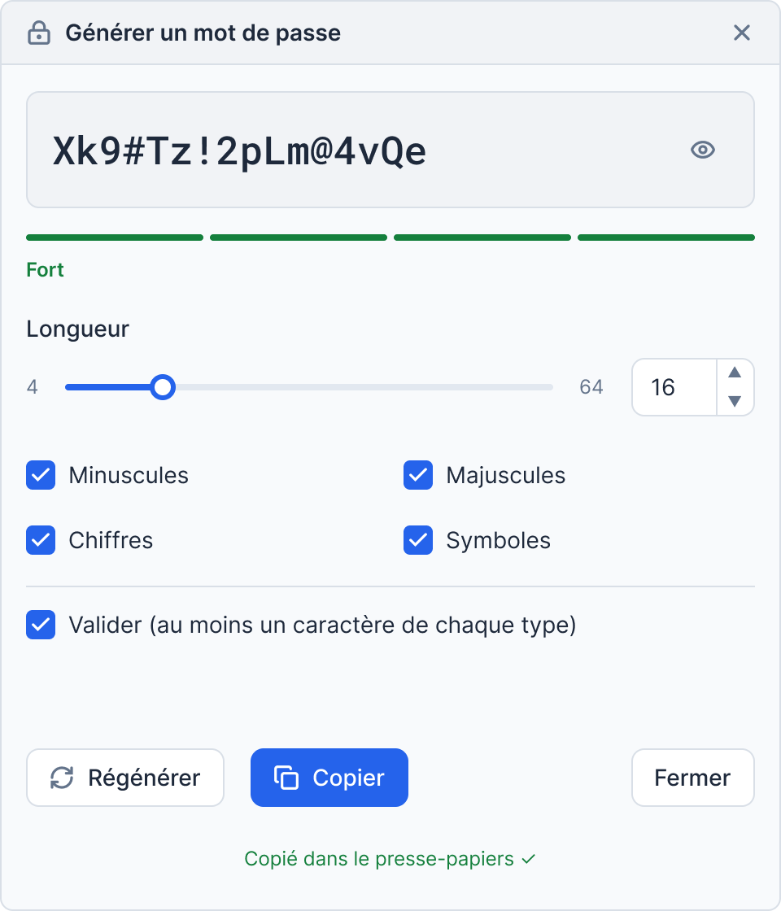
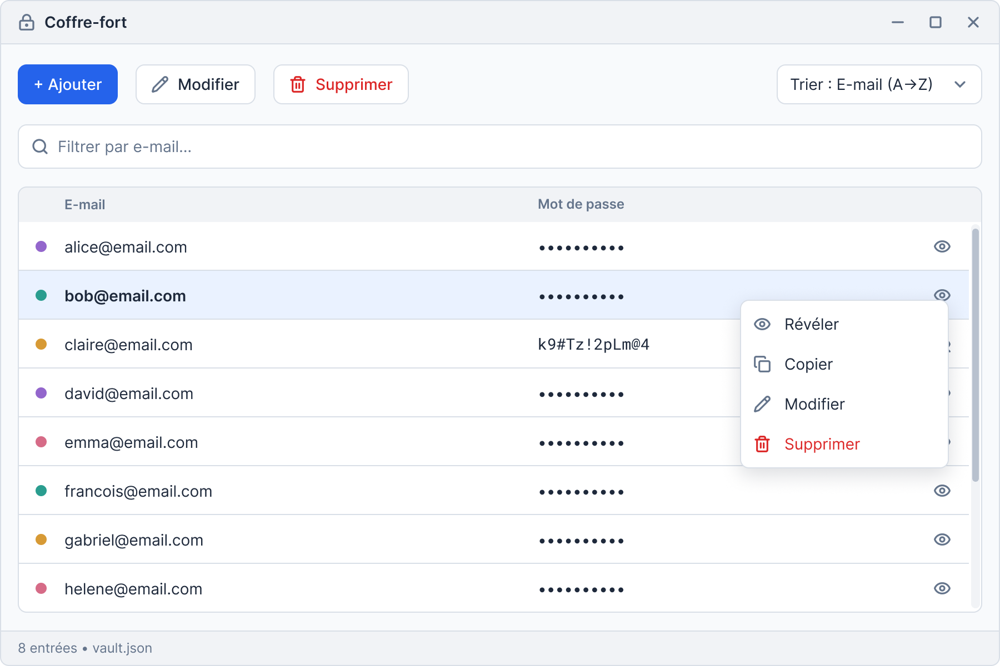
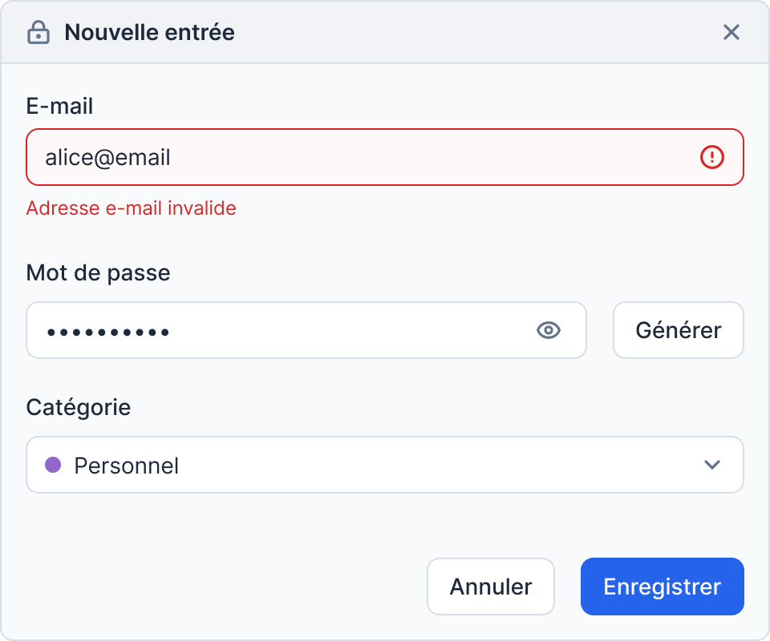

# Gestionnaire de mots de passe

Travail pratique 1 : programmation orientée objet, interface en ligne de commande (CLI) et interface graphique (PySide6).

**Auteur :** Timothée Philibert, n° étudiant 2507084, GitHub : `timotheephlb`

## Description

Application de gestion de mots de passe, en deux parties :

- **Partie 1 (branche `partie1`)** : moteur de génération de mots de passe (`app/core/generator.py`) et son interface en ligne de commande.
- **Partie 2 (branche `partie2`)** : interface graphique « Coffre-fort » (PySide6) qui permet de générer, enregistrer, modifier et supprimer des couples e-mail / mot de passe, sauvegardés dans un fichier JSON.

## Prérequis

- Python 3.14 (voir `.python-version`)
- [uv](https://docs.astral.sh/uv/) pour gérer l'environnement virtuel et les dépendances
- PySide6 (installé automatiquement par `uv sync`, uniquement requis à partir de la partie 2)

## Installation

```bash
git clone https://github.com/timotheephlb/tp1-generateur-de-mot-de-passe.git
cd tp1-generateur-de-mot-de-passe
git checkout partie2
uv sync
```

## Utilisation

```bash
uv run main.py [options]
```

Sans option, l'interface graphique du coffre-fort s'ouvre. Avec `--no-gui`, le programme fonctionne en ligne de commande (partie 1).

| Argument           | Description                                                      | Défaut       |
|--------------------|------------------------------------------------------------------|--------------|
| `--no-gui`         | Mode ligne de commande : affiche un mot de passe et quitte       | interface    |
| `--vault_file F`   | Fichier JSON du coffre-fort (mode graphique)                     | `vault.json` |
| `--length N`       | Longueur du mot de passe (mode CLI)                              | `16`         |
| `--no-lower`       | Exclut les minuscules                                            | incluses     |
| `--no-upper`       | Exclut les majuscules                                            | incluses     |
| `--no-digits`      | Exclut les chiffres                                              | inclus       |
| `--no-symbols`     | Exclut les symboles                                              | inclus       |
| `--validate`       | Exige au moins un caractère de chaque type sélectionné           | désactivé    |

### Exemples

```bash
# Ouvrir le coffre-fort (fichier vault.json)
uv run main.py

# Ouvrir un autre coffre-fort
uv run main.py --vault_file mon_coffre.json

# Mode CLI : 24 caractères, sans symboles, avec validation
uv run main.py --no-gui --length 24 --no-symbols --validate
```

## Interface graphique

### Fenêtre principale : Coffre-fort

- Liste défilante des entrées : e-mail et mot de passe masqué (`*******`).
- **Double-clic** sur une ligne, ou **clic droit** puis « Révéler / Masquer » : affiche ou masque le mot de passe.
- **Ajouter**, **Modifier** et **Supprimer** (avec confirmation) ; le clic droit propose aussi Modifier et Supprimer.
- **Tri** par e-mail (A → Z ou Z → A).
- Le coffre-fort est chargé au démarrage et enregistré à la fermeture de la fenêtre.

### Boîte de dialogue : Nouvelle entrée / Modifier l'entrée

- Vérifie que l'e-mail contient un « @ », qu'il n'existe pas déjà (sans tenir compte de la casse) et que le mot de passe n'est pas vide. En cas d'erreur, la boîte reste ouverte.
- Le bouton **Générer** ouvre la fenêtre de génération ; le mot de passe choisi remplit le champ.

### Fenêtre de génération

- Longueur réglable avec un curseur et une boîte numérique synchronisés (4 à 64).
- Cases à cocher pour les minuscules, majuscules, chiffres, symboles et la validation.
- Mot de passe affiché en grand et sélectionnable, avec un bouton pour le masquer (`****`).
- Boutons Régénérer, Copier (presse-papiers) et Utiliser.

## Fichier du coffre-fort

Le coffre-fort est un fichier JSON **en texte clair** (exigence du TP : aucun chiffrement). Il ne doit pas être versionné : `vault.json*` est dans le `.gitignore`.

```json
[
    {
        "email": "alice@email.com",
        "mot_de_passe": "k9#Tz!2pLm"
    }
]
```

### Gestion des erreurs

- Fichier absent : le coffre-fort démarre vide et le fichier est créé à la fermeture.
- Fichier illisible, corrompu ou de format inattendu : un message d'erreur s'affiche, le coffre démarre vide et **le fichier d'origine n'est pas écrasé** à la fermeture.
- Échec d'écriture à la fermeture : l'utilisateur peut choisir de rester dans l'application ou de quitter.

## Structure du projet

```
TP1/
├── .gitignore
├── .python-version
├── pyproject.toml
├── uv.lock
├── main.py                    # Point d'entrée (interface graphique ou CLI)
├── README.md
├── doc/                       # Maquettes
└── app/
    ├── __init__.py
    ├── core/
    │   ├── __init__.py
    │   ├── generator.py       # Classe PasswordGenerator
    │   └── storage.py         # Classes Entree et Storage (lecture / écriture JSON)
    └── ui/
        ├── __init__.py
        ├── main_window.py     # FenetrePrincipale (liste, tri, CRUD, sauvegarde)
        ├── formulaire_entree.py  # FormulaireEntree (ajout / modification)
        ├── generator_ui.py    # FenetreGenerateur
        └── style.py           # Feuille de style
```

## Logique métier

### PasswordGenerator (`app/core/generator.py`)

```python
from app.core.generator import PasswordGenerator

# longueur, minuscules, majuscules, chiffres, symboles, validation
gen = PasswordGenerator(16, True, True, True, True, False)
print(gen.generer())
```

Elle lève une `ValueError` si la longueur est inférieure ou égale à 0, si aucun type de caractère n'est sélectionné, ou si la validation est activée avec une longueur inférieure au nombre de types.

| Méthode                 | Rôle                                                                                   |
|-------------------------|----------------------------------------------------------------------------------------|
| `generer()`             | Retourne un mot de passe (régénère jusqu'à ce qu'il soit valide si la validation est activée). |
| `valider(mot_de_passe)` | Vérifie qu'il contient au moins un caractère de chaque type sélectionné.               |

### Entree et Storage (`app/core/storage.py`)

- `Entree` : un couple e-mail / mot de passe, avec `vers_dict()` et `depuis_dict()` pour passer de et vers le JSON.
- `Storage(chemin)` : `charger()` lit le fichier (liste vide s'il n'existe pas, `ValueError` s'il est invalide) et `sauvegarder(entrees)` l'écrit.

## Notes de conception

- La liste est un `QListWidget` placé dans un `QScrollArea`, comme l'éditeur de texte du cours.
- Le double-clic et le clic droit s'appuient sur `itemDoubleClicked` et `customContextMenuRequested` (API Qt non couverte par les exemples du cours).

## Maquettes

### Fenêtre de génération de mot de passe



### Fenêtre principale : Coffre-fort



### Boîte de dialogue : Nouvelle entrée

